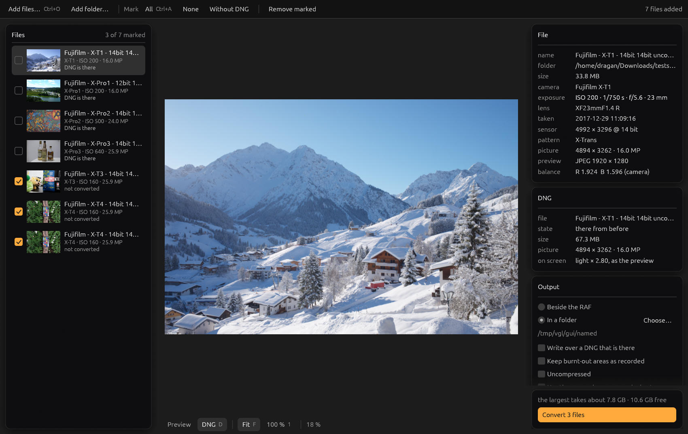

# Mimizan Lab X-Trans

> A Fuji X-Trans RAF in, a linear DNG out.

`xtrans2dng` turns the RAF of a Fuji X-Trans camera into a DNG that holds red, green and blue for every pixel. The mosaic is not interpolated. It is taken apart into the luminance and the two chrominances it carries on the tile's own frequencies, under the prior the mosaic itself makes most probable.

It is the companion of [Mimizan Lab](https://github.com/Draganito/mimizan), the darkroom that reads a Bayer mosaic the same way. Mimizan Lab does not read X-Trans; from 0.19.0 it opens the DNG this program writes. Any raw developer that reads a linear DNG opens it too.

```bash
xtrans2dng DSCF3861.RAF
```

writes `DSCF3861.dng` beside the RAF.

## What comes out

A DNG with three 16-bit channels a pixel, in the camera's own colours:

- **Linear.** No tone curve, no colour profile applied, no sharpening, no noise reduction, no lens correction. The separation runs under the sRGB curve, where the noise is nearly the same at every level, and each channel is taken back to linear before it is written.
- **Not balanced.** The channels are the sensor's. The camera's white balance is in the file as the as-shot neutral, with the colour matrices for daylight and tungsten, so a raw developer balances and profiles the DNG as it would the RAF.
- **The camera's data.** Exposure, lens, orientation and the camera's own JPEG as the preview are carried over.
- **Black at 0, white at 65535.** The RAF's black level is taken off. What lay below black in the noise is cut to black (0.1 % of the values of a frame at ISO 3200).
- **Nearly the whole frame.** The frame ends on symmetry lines of the tile, so at most seven columns and seven rows of the RAF's picture are left out: 6238 x 4159 of 6240 x 4160, 5998 x 3997 of 6000 x 4000.
- **Losslessly compressed**, about 80 to 115 MB for 24 and 26 megapixels. `--uncompressed` writes it half as large again.

## Get it

Debian and Ubuntu, 64-bit Intel and AMD: [mimizan-lab-xtrans_0.4.1-1_amd64.deb](https://github.com/Draganito/mimizan-lab-xtrans/releases/download/v0.4.1/mimizan-lab-xtrans_0.4.1-1_amd64.deb). Install the downloaded file:

```bash
sudo apt install ./mimizan-lab-xtrans_0.4.1-1_amd64.deb
```

That installs the `xtrans2dng` command and [the window](#the-window), `xtrans2dng-gui`, with an entry in the applications menu.

Windows, 64-bit Intel and AMD: [mimizan-lab-xtrans-0.4.1-x86_64-windows.zip](https://github.com/Draganito/mimizan-lab-xtrans/releases/download/v0.4.1/mimizan-lab-xtrans-0.4.1-x86_64-windows.zip). Unzip it and start `xtrans2dng-gui.exe`; `xtrans2dng.exe` beside it is the command. The programs carry the Visual C++ runtime, and the window draws with DirectX 12 and opens without a terminal. An unsigned download asks SmartScreen for confirmation.

Apple silicon: [mimizan-lab-xtrans-0.4.1-aarch64-macos.zip](https://github.com/Draganito/mimizan-lab-xtrans/releases/download/v0.4.1/mimizan-lab-xtrans-0.4.1-aarch64-macos.zip). Unzip it and open `Mimizan Lab X-Trans.app`. The command is `Mimizan Lab X-Trans.app/Contents/MacOS/xtrans2dng`. The programs use what comes with macOS. The download is not signed: if macOS will not open the app, or says it is damaged, open a terminal next to the unzipped app and run this to clear the quarantine flag and sign it locally:

```bash
xattr -cr "Mimizan Lab X-Trans.app" && codesign --force --deep -s - "Mimizan Lab X-Trans.app"
```

From the source, with Rust 1.88 or later:

```bash
cargo build --release
target/release/xtrans2dng --help
cargo build --release -p mimizan-lab-xtrans-gui
target/release/xtrans2dng-gui
```

It was written on Linux. The Windows and the macOS programs are built on GitHub's machines, where their tests pass and the window opens from the unpacked archive, and both have been tried by hand since.

## Use it

```
xtrans2dng [OPTIONS] <RAF>...
```

Every RAF gives a DNG of its name beside it. A DNG that is there already is left alone and the file counts as not converted.

| Option | What it does |
| --- | --- |
| `-o`, `--out <PATH>` | Where the DNG goes: a directory, or with one RAF a file name. |
| `-f`, `--force` | Write over a DNG that is already there. |
| `--keep-highlights` | Leave burnt-out areas as recorded (see below). |
| `--uncompressed` | Write the picture uncompressed. |
| `-q`, `--quiet` | Say nothing but errors. |

While it works it says what it found: the camera, the prior, the share of burnt-out photosites, the times. A DNG is written under another name and renamed when it is whole, so a DNG that is there is finished. When a file fails the others are still converted, and the command ends with an error.

## The window

`xtrans2dng-gui` is the same conversion with a list in front of it, for more than a few files.



- **Add** RAFs or folders with the buttons, or drop them on the window. Each file shows the camera's preview and what it says about itself: camera, exposure, lens, sensor, and the size the DNG will have.
- **Mark** the files to convert: the box in a row, Space, Shift for a range, or All, None and Without DNG in the toolbar. A file comes in marked unless its DNG is there already.
- **Convert** runs the marked files one after the other. The row and the panel at the right say how far the file in work is; "Stop after this file" ends the run there.
- **When a file is done** its DNG is read back and shown in the preview's place. To be looked at it is balanced, taken to sRGB by its own matrix, made as light as the preview and given a mild contrast; the file is not touched by that. `D` goes between preview and DNG, the wheel enlarges, `1` is one pixel on one, `F` the whole picture.

The DNGs go beside their RAFs or into one folder, and they are the ones the command writes, byte for byte. A file that needs more memory than is free when its turn comes is left out and says so.

## What it takes

A 26-megapixel file takes about three quarters of a minute and close to 8 GB of memory: 43 to 45 s and a peak of 7.8 GB on a Ryzen 7 5700U (eight cores). Files are converted one after the other, so the memory is that of one file. A machine with 8 GB does not have that much free.

## Highlights

Where a channel is burnt out, the sensor says nothing about the colour. By default the balanced mosaic is cut at the level the first channel burns out at: a burnt-out area comes out flat and neutral, and no false colour spreads from it into what lies around it.

`--keep-highlights` leaves the mosaic as recorded there. The channels that still hold something above that level stay in the DNG, for a raw developer's highlight recovery. The prior is found on the cut mosaic either way.

## Where the DNG opens

Tried with the files of two cameras, an X-Pro3 (26 megapixels, at ISO 160 and ISO 3200) and an X-E3 (24 megapixels, a compressed RAF with a burnt-out sun):

- **darktable 5.0.1** and **RawTherapee 5.11** show the picture of the RAF.
- **LibRaw** (`dcraw_emu`) does too, and reads the compressed DNG to the same values as the uncompressed one.
- **Mimizan Lab 0.19.0** opens it as a colour file with three channels: the monochrome negative, the plate and the print are those of a Bayer file, without a separation step.

The DNG says black is 0 rather than carrying the RAF's black level, because darktable 5.0 does not read that tag for a picture of three channels and showed such a file grey and magenta.

## What it does

It is a demosaicer, and it is not what Mimizan Lab does with a Bayer file. There, every pixel is one clean measurement and nothing is estimated. Here, one reading per photosite goes in and three colour values per pixel come out, worked out from the readings around it. The mosaic is not filled in by guessing: brightness and colour are read off the frequencies where the X-Trans pattern carries them.

- **More of the real detail, less false colour.** As sharp as RawTherapee's 3-pass, with about a third of the false colour.
- **The colour of the fine detail stays.** Nothing goes back over the picture to clean it up, so the real colour is not taken away with the false.
- **Less noise, and calmer.** About half the colour noise at high ISO.
- **A DNG your developer already opens.** Linear, in the camera's own colours: black at 0, white at 65535, no tone curve, the white balance left for the developer. It opens the file the way it opens the RAF.

The comparison behind the numbers is [below](#against-rawtherapee): one test chart from an X-Pro3, at ISO 160 and ISO 3200, both pictures printed by Mimizan Lab 0.19.0 and measured on the 8-bit prints. The finest lines, 2 to 2.8 pixels apart, are not there yet: RawTherapee's are calmer.

## Against RawTherapee

Compared with the "3-pass" of RawTherapee 5.11 on a test chart taken with the X-Pro3 at ISO 160 and at ISO 3200. Both pictures went through the same developer with the same settings: RawTherapee's picture was written as a linear DNG too, and Mimizan Lab 0.19.0 printed both. Measured on the 8-bit prints, in steps of 255, at ISO 160 / ISO 3200:

| | 3-pass | 3-pass, false colour suppression 3 | xtrans2dng |
|---|---|---|---|
| Edge contrast in the Siemens star | 34.0 / 36.5 | 33.5 / 35.7 | 33.3 / 35.8 |
| False colour in small white print on black | 20.5 / 30.3 | 6.1 / 11.7 | 6.3 / 9.8 |
| Colour noise in a dark, flat area | 4.0 / 20.3 | 1.7 / 8.5 | 2.4 / 10.0 |
| Colour contrast in fine coloured rings | 70.7 / 73.6 | 53.8 / 54.8 | 74.7 / 76.8 |
| Unrest along lines 2 to 2.8 px apart, ISO 160 | 0.60 | not measured | 0.88 |

It is as sharp as 3-pass with about a third of its false colour and half its colour noise, and it keeps the colour of fine detail, which the suppression takes out. Lines near the sensor's limit are not as calm as RawTherapee's yet; the blank paper beside them measures 0.56. It takes 45 s where RawTherapee takes about 5.

## What is not known

- **How it stands against other X-Trans demosaicers** than RawTherapee's 3-pass, and on other pictures than one test chart and one landscape.
- **Other cameras.** Only the two above were tried. The file is decoded by [rawler](https://github.com/dnglab/dnglab); a RAF it reads and whose tile is an X-Trans one should convert, and a file with another mosaic is refused ("not an X-Trans mosaic").
- **Other raw developers** than the three above.

## How it works

The 6 x 6 tile has green on five of nine photosites, and red and blue exchanging places on the rest. Read as a signal, the mosaic is a luminance with two chrominances on carriers: green against red and blue on eight of them, red against blue on four. No carrier sits at Nyquist, and they lie closer together than a Bayer mosaic's, so a filter around each carrier, which is how a Bayer mosaic comes apart, loses the colour's detail here.

Instead the luminance and both chrominances of the 36 frequencies the tile ties together are solved at once, by least squares under a prior: how fast luminance and colour fall with frequency, how much colour there is, how much noise, how soft the lens. That prior is searched on the mosaic itself. Twenty-one priors are then weighed against each other pixel by pixel by how well each explains the mosaic around it: more or less colour, pictures that vary along one direction only, which is what a straight edge is, and lines near the sensor's limit, which otherwise leave the dots of the tile along them.

A second step follows where the picture has two colours. There every photosite measures the same quantity through its own gain and the colour is as sharp as the mosaic; this takes out the dots the first step leaves along a hard edge of colour.

The method was grown as an experiment beside Mimizan Lab. What was tried, what was left behind and why is written at the top of [`src/xtrans.rs`](src/xtrans.rs).

## Licence

GPL-3.0-or-later. See [LICENSE](LICENSE).
